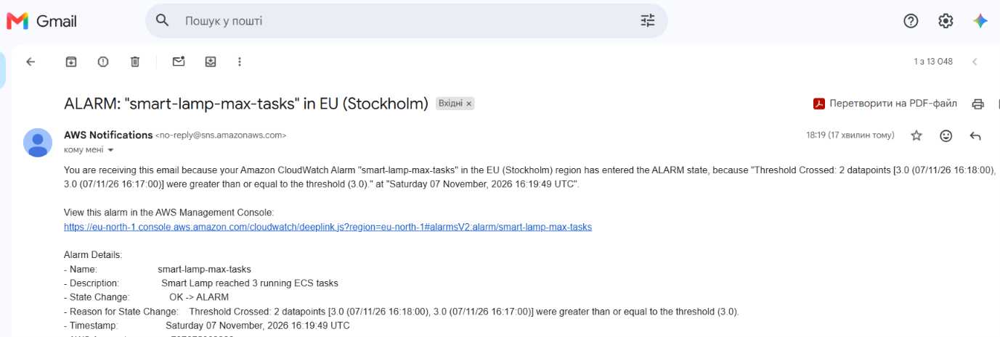
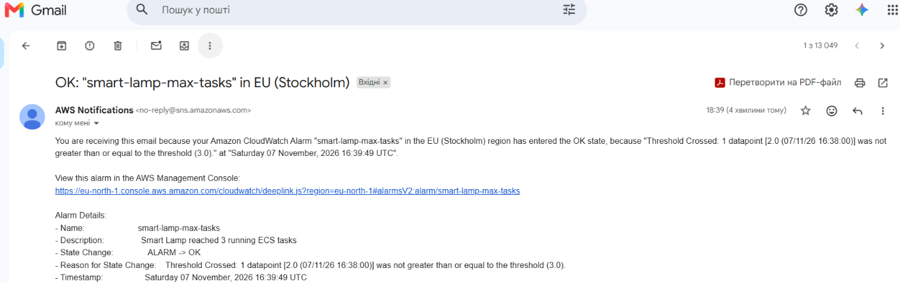
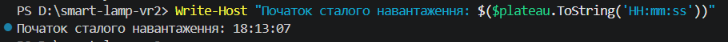

# Сповіщення CloudWatch для Smart Lamp

## 1. Умова спрацювання

Обрана умова — досягнення максимальної кількості ECS Tasks.

Для моніторингу надмірного навантаження налаштовано CloudWatch Alarm `smart-lamp-max-tasks`.

Параметри:
- Метрика — `RunningTaskCount` (`ECS/ContainerInsights`).
- Поріг — 3 Tasks.
- Статистика — `Minimum`.
- Період — 60 секунд.
- Кількість періодів оцінювання — 2.
- Канал доставки — Amazon SNS, протокол `email`.

Умова обрана тому, що максимальна кількість Tasks у сервісі становить 3. Її досягнення означає, що автоматичне масштабування використало весь налаштований резерв екземплярів і подальше збільшення навантаження може погіршити продуктивність застосунку.

Сповіщення надсилаються через SNS при переходах стану CloudWatch Alarm: `OK → ALARM` та `ALARM → OK`.

## 2. Сповіщення про надмірне навантаження

*Рис. 1 — Лист Amazon SNS про перехід CloudWatch Alarm у стан ALARM.*

Під час навантажувального тестування k6 із 15 віртуальними користувачами CloudWatch зафіксував 3 працюючі Tasks протягом двох періодів.

7 листопада 2026 року о **18:19:49 (UTC+2)** стан змінився з `OK` на `ALARM`, після чого Amazon SNS надіслав сповіщення електронною поштою.

## 3. Сповіщення про повернення до норми

*Рис. 2 — Лист Amazon SNS про перехід CloudWatch Alarm зі стану ALARM у стан OK.*

7 листопада 2026 року о **18:39:49 (UTC+2)** CloudWatch Alarm перейшов зі стану `ALARM` у стан `OK`.

Згідно з повідомленням, `RunningTaskCount` зменшився до 2, тобто став нижчим за поріг 3 Tasks. Amazon SNS успішно доставив друге сповіщення.

## 4. Час реакції системи

Початок сталого навантаження k6 — **18:13:07**.

*Рис. 3 — Час початку сталого навантаження, визначений перед запуском k6 у PowerShell.*

Перехід CloudWatch Alarm у стан `ALARM` — **18:19:49**.

Час від початку сталого навантаження до спрацювання тривоги становив **6 хвилин 42 секунди**. Фактична доставка першого листа могла відбутися трохи пізніше.

Для навчального проєкту така затримка є прийнятною, оскільки система зафіксувала досягнення максимальної кількості ECS Tasks і повідомила про це електронною поштою.

Для реального сервісу 6 хвилин 42 секунди можуть бути завеликим часом реагування, особливо за високих вимог до доступності. Доцільно додатково контролювати латентність і кількість серверних помилок, щоб виявляти проблеми до досягнення максимального масштабу.