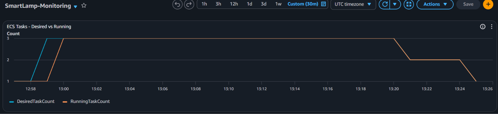
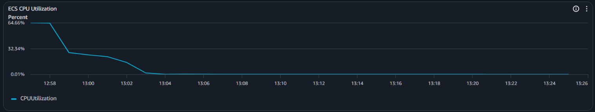
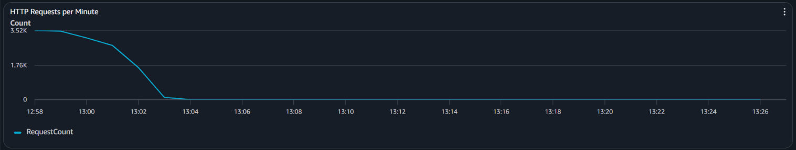
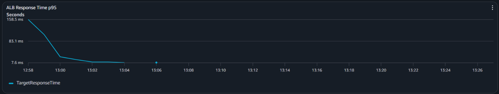
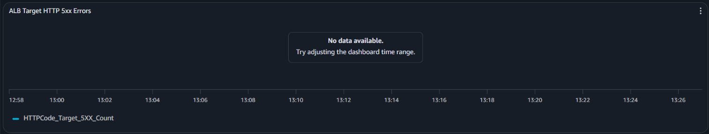

# Автоматичне масштабування Smart Lamp

## 1.Обрані параметри масштабування

Сервіс — Amazon ECS Fargate  
Тип масштабування — TargetTrackingScaling  
Метрика — ALBRequestCountPerTarget  
Цільове значення — 500 запитів на один Target за хвилину  
Мінімальна кількість Tasks — 1  
Максимальна кількість Tasks — 3  
Scale-out cooldown — 60 секунд  
Scale-in cooldown — 180 секунд

## 2.Обґрунтування цільового значення

Цільове значення 500 запитів за хвилину обрано як початковий поріг для навчального тестування. Воно відповідає приблизно 8 запитам за секунду на один екземпляр, що дозволяє створити помітне навантаження на застосунок. Нижче значення могло б спричиняти занадто часте масштабування навіть за невеликого навантаження, а значно вище — ускладнити досягнення необхідного рівня запитів під час тестування.

## 3.Період стабілізації (Cooldown)

Cooldown — це період стабілізації після масштабування, протягом якого AWS обмежує наступні зміни кількості Tasks, щоб уникнути занадто частого збільшення або зменшення ресурсів.

У нашому випадку scale-out cooldown становить 60 секунд, а scale-in cooldown — 180 секунд. Довший період для зменшення кількості Tasks обрано, щоб система не прибирала ресурси занадто швидко після зниження навантаження.

Якщо встановити cooldown рівним нулю, додаткового періоду стабілізації не буде. AWS зможе частіше змінювати кількість Tasks, що може спричинити коливання між збільшенням і зменшенням ресурсів. Водночас масштабування не стане миттєвим, оскільки потрібен час на збір метрик і запуск контейнерів.

## 4. Результати моніторингу CloudWatch

Для моніторингу роботи Smart Lamp створено CloudWatch Dashboard із п'ятьма графіками. Під час тестування k6 із 15 віртуальними користувачами було зафіксовано автоматичне збільшення та подальше зменшення кількості ECS Tasks.

### 4.1. Автоматичне масштабування ECS Tasks

*Рис. 1 — Зміна DesiredTaskCount та RunningTaskCount під час і після навантаження.*

На графіку видно повний цикл масштабування: **1 - 3 - 2 - 1 Tasks**.

За даними AWS Scaling Activities:

- **12:58:52** — збільшення DesiredTaskCount до 3.
- **13:20:26** — зменшення DesiredTaskCount до 2.
- **13:24:26** — повернення DesiredTaskCount до 1.

Затримка між перевищенням порогу навантаження та появою додаткових Tasks пояснюється тим, що CloudWatch спочатку збирає й оцінює метрики, після чого Auto Scaling змінює бажану кількість Tasks. ECS потрібен додатковий час для запуску контейнерів і перевірки їхньої готовності.

Зменшення кількості Tasks відбувається пізніше за спад навантаження, оскільки AlarmLow оцінює **15 періодів по 60 секунд**, а Scale-in cooldown становить **180 секунд**. Це допомагає уникати частих коливань кількості контейнерів.

### 4.2. Використання CPU

*Рис. 2 — Завантаження процесора ECS.*

Після завершення навантаження використання CPU зменшилося майже до нуля.

### 4.3. Кількість HTTP-запитів

*Рис. 3 — Кількість HTTP-запитів через ALB за хвилину.*

### 4.4. Час відповіді ALB

*Рис. 4 — 95-й перцентиль часу відповіді ALB.*

Після спаду навантаження час відповіді зменшився.

### 4.5. Серверні помилки HTTP 5xx

*Рис. 5 — Кількість серверних помилок HTTP 5xx.*

У вибраному часовому інтервалі CloudWatch не відображав значень метрики HTTPCode_Target_5XX_Count. За результатами k6 із 31 140 HTTP-запитів один був невдалим (0,0032%). Цей показник охоплює не лише серверні помилки HTTP 5xx, тому результати не суперечать один одному.